

  <picture>
    <source media="(prefers-color-scheme: dark)" srcset="images/logo-dark.png" />
    <source media="(prefers-color-scheme: light)" srcset="images/logo-light.png" />
    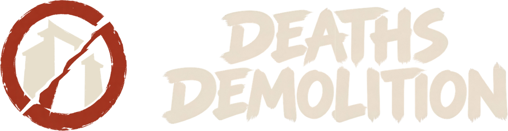
  </picture>
  
<strong>Top-down wave-survival zombie shooter · Unity 2022.3 LTS · URP 14 · C#</strong>

  
<em>An old palace, a garden, and a crowd that never stops arriving.</em>

  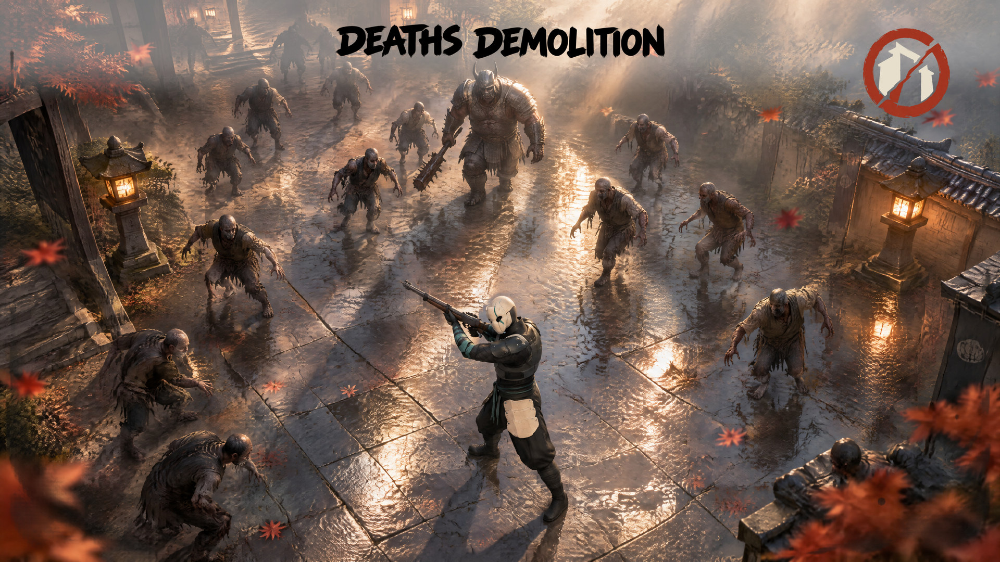

Key art

Deaths Demolition is a top-down wave-survival shooter. You hold an old Japanese palace compound against crowds of up to 40 zombies at once. Ten classic weapons, two chain-reaction Specials and ten wall-buy stations feed a feature-based upgrade tree. Round by round, that tree turns an ordinary rifle into something absurd: triple shots, seeker swarms, full-auto rockets, black holes. Three difficulty modes set the pace. Normal is the long game, Hard hits faster and harder, and in Demolition the crowd runs, cuts off your escape and is built so that nobody lasts long.

> **Status (15 Oct 2026):** in active development. Revision round R4, the final round of milestone M4, closed on 15 Oct 2026 after its scripted acceptance run; the macOS release build of R4 is done.
>
> Source code, builds and production assets are private. This page shows the game and the engineering behind it. Every gameplay image here was captured from the R4 build.

| | |
| --- | --- |
| **Genre** | Top-down wave-survival shooter, single player, offline |
| **Engine** | Unity 2022.3.22f1 LTS · Universal Render Pipeline 14 · C# |
| **Platform** | macOS (Metal) release builds; a Windows x64 build path exists |
| **Crowd** | Up to 40 zombies at once, 4 tiers, 5 attack styles |
| **Arsenal** | 10 classic weapons · 2 Specials · 10 wall-buy stations |
| **Progression** | 7-branch run tree (63 nodes, 7 alternative capstones, 10 synergies) · 11-node Awakening page |
| **Modes** | Normal · Hard · Demolition |
| **Languages** | English and Turkish (1,346 strings, all bilingual) |
| **Codebase** | ≈ 487k lines of C# · 3,591 automated test cases · 142 tool scripts |

---

## Contents

1. [Screenshots](#screenshots)
2. [How a run plays](#how-a-run-plays)
3. [Arsenal](#arsenal)
4. [Enemies and AI](#enemies-and-ai)
5. [Progression](#progression)
6. [World and look](#world-and-look)
7. [Game feel and audio](#game-feel-and-audio)
8. [Interface and accessibility](#interface-and-accessibility)
9. [Architecture](#architecture)
10. [Performance](#performance)
11. [Engineering profile](#engineering-profile)
12. [Production pipeline](#production-pipeline)
13. [Roadmap](#roadmap)

---

## Screenshots

### Gameplay

  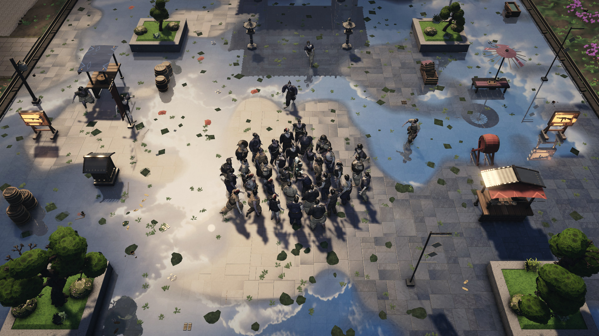

The 40-body ceiling on the wet-stone plaza

<table>
  <tr>
    <td width="50%"> Hard mode, round VIII: HUD v4 with gold above health and the brush numeral</td>
    <td width="50%">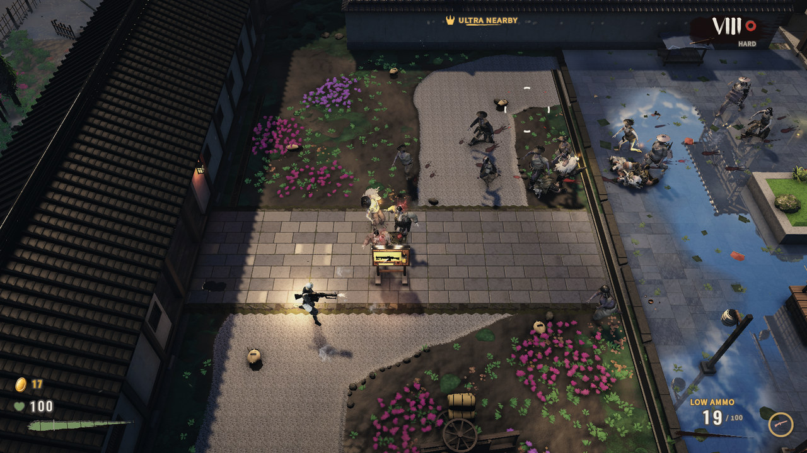 Automatic fire: bullets drawn as short-exposure streaks</td>
  </tr>
  <tr>
    <td width="50%">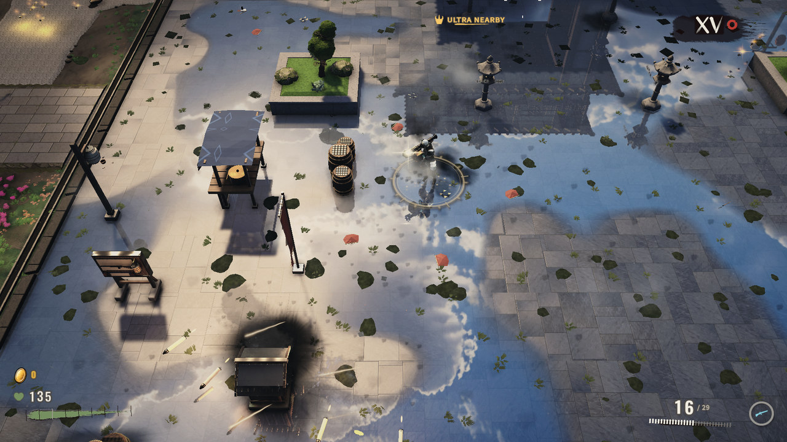 Rockets in flight and a blast scorch on the plaza, round XV</td>
    <td width="50%"> The Barrage synergy: full-auto rockets late in a run</td>
  </tr>
  <tr>
    <td width="50%">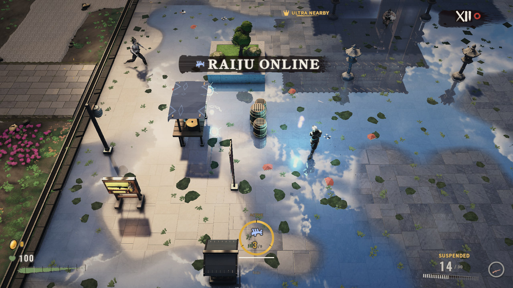 Raiju, the chain-lightning Special</td>
    <td width="50%">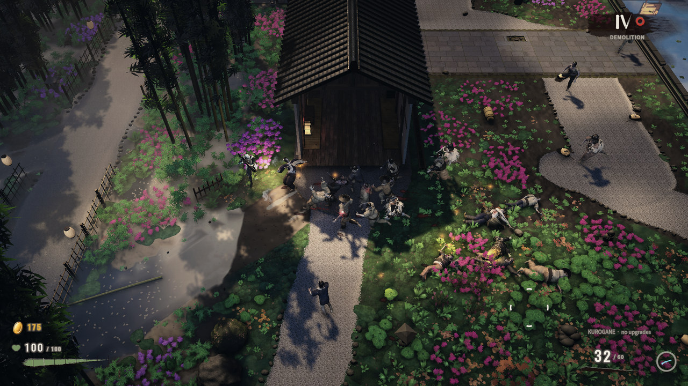 Demolition mode, round IV: running crowds from the first rounds</td>
  </tr>
  <tr>
    <td width="50%">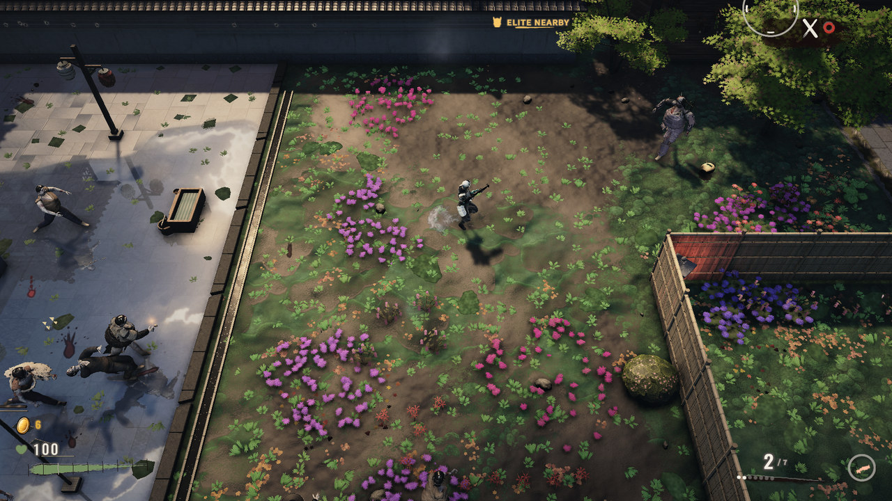 Close quarters in the flower garden with a pump shotgun</td>
    <td width="50%">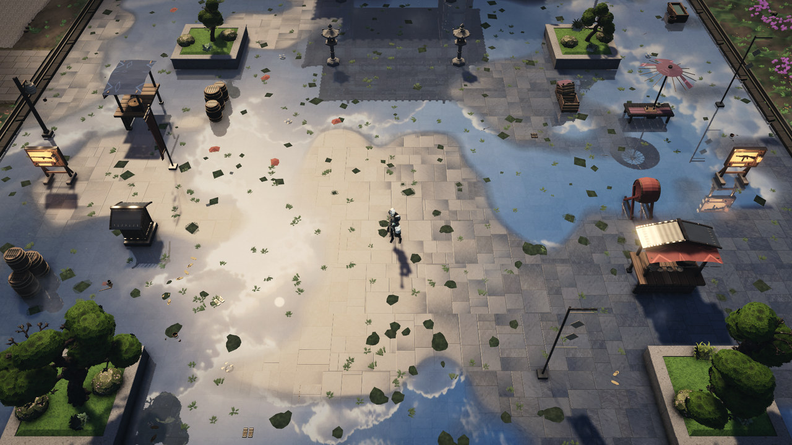 After-rain plaza: wet slate with planar sky reflection</td>
  </tr>
</table>

### The world

<table>
  <tr>
    <td width="50%"> Garden court: instanced flowers and grass, stone path</td>
    <td width="50%">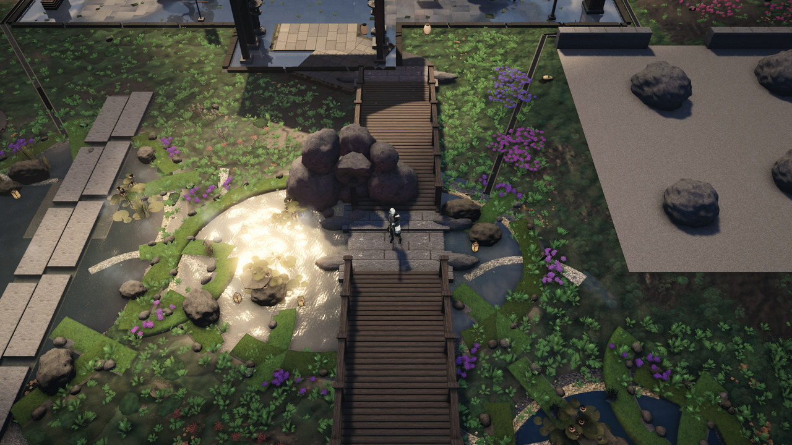 Bridge and pond in the garden</td>
  </tr>
  <tr>
    <td colspan="2">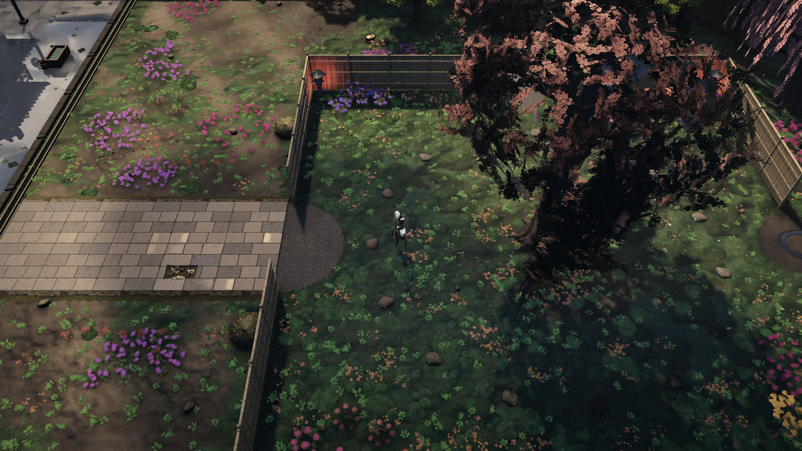 Sakura court: living ground with wind and an interaction push map</td>
  </tr>
</table>

### Interface

<table>
  <tr>
    <td width="50%"> Main menu: brush wordmark and seal over a live cinematic of the world</td>
    <td width="50%"> Loading: the seal drops into the ensō progress ring</td>
  </tr>
  <tr>
    <td width="50%"> Prepare Run: difficulty, map, a 3D weapon turntable and five stat cards</td>
    <td width="50%">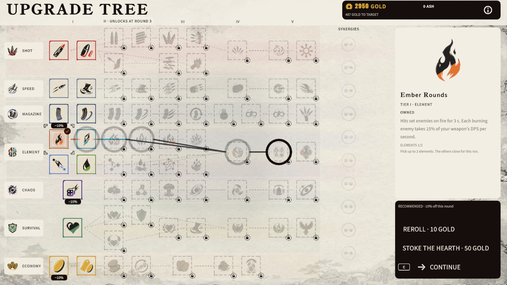 The run tree between rounds: seven branches, recommendations and reroll</td>
  </tr>
  <tr>
    <td width="50%"> Awakening: alternative capstones and fork widenings bought with Ash</td>
    <td width="50%"> Settings and accessibility in the brush-ink kit</td>
  </tr>
</table>

### In motion

<table>
  <tr>
    <td width="50%">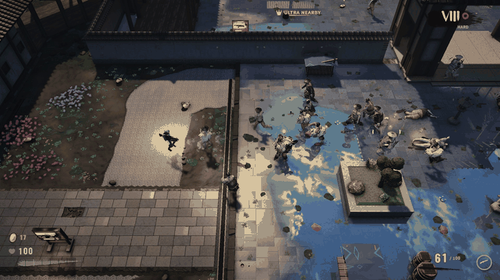 Crowd fight, Hard mode</td>
    <td width="50%">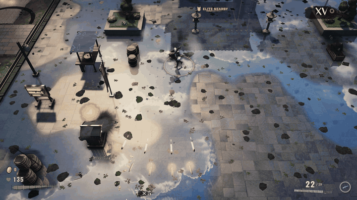 Explosion chain with the Barrage synergy</td>
  </tr>
  <tr>
    <td width="50%">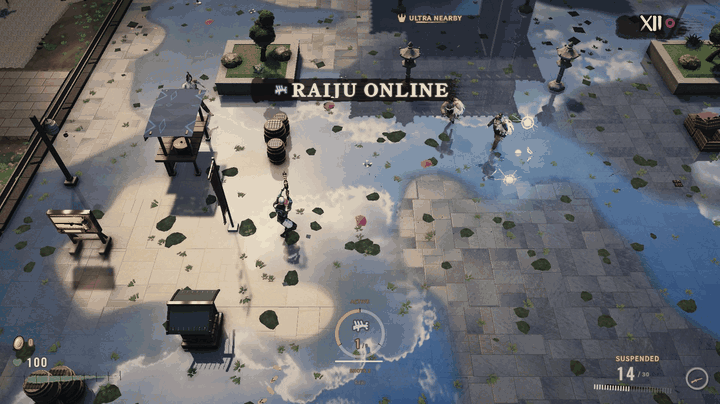 Raiju on the field</td>
    <td width="50%"> The logo reveal used on the loading screen</td>
  </tr>
</table>

Gameplay images are captured from the R4 build with the game camera; a few shots use a capture camera at 0.8 of the default distance. Gameplay shots were played by the game's scripted test bot, invulnerable for the capture.

---

## How a run plays

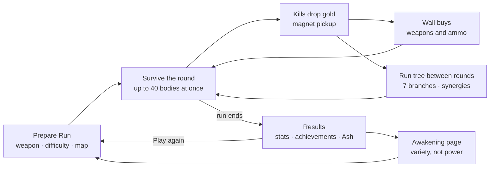

- **Prepare Run.** Pick a starting weapon on a 3D turntable with five stat cards, a difficulty and the map. All classic weapons except the launcher are open from the first run. There is no level-gated unlock.
- **Rounds.** Each round has a body pool, a target and an active ceiling of 40. A threat director weights where zombies come from across 22 authored spawn gates. From round 16, enemy health grows by ×1.45 per round in every mode.
- **Gold and wall buys.** Kills drop pooled gold orbs pulled in by a magnet. Ten Call-of-Duty-style wall stations sell the weapons of the run: buying the weapon in hand again refills ammo at half price. The rocket launcher waits at a far shrine for 2,500 gold.
- **Specials.** The two Specials are never chosen. They appear on the field and park your classic weapon while you carry them.
- **Between rounds,** gold buys nodes on the run tree, and each node applies to whatever weapon you hold.
- **After the run,** Results converts the run into Ash. Ash buys Awakening nodes: alternative capstones and fork widenings that add variety, never raw power. **Play again** returns to Prepare Run with the last selection.

### Difficulty modes

| Mode | What changes |
| --- | --- |
| **Normal** | The full game; the long late-round climb with the tree's power fantasy untouched. |
| **Hard** | Damage ×1.4, shorter telegraphs, 55 % of the crowd pursues where you *will* be, active cap 36, gold ×1.25. |
| **Demolition** | Running crowds from round 1, Runner / Elite / Ultra tiers from rounds 1 / 2 / 3, 60 % of the crowd intercepts and 40 % cuts off your escape path, damage ×1.8, gold ×1.8 and 150 starting gold. Bots die around round 5–6. |

---

## Arsenal

  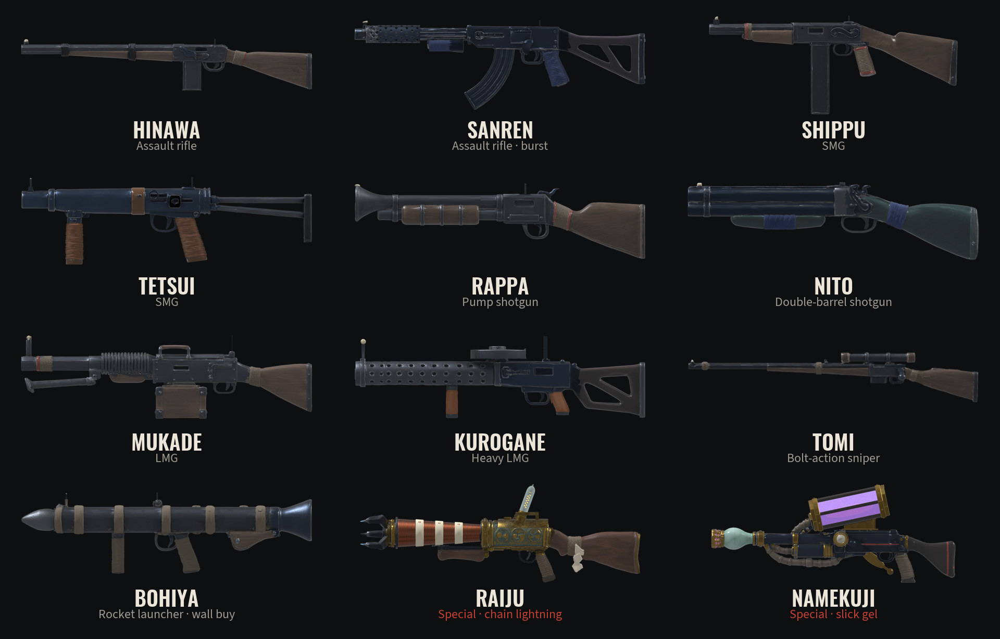

| Weapon | Class | Fire | RPM | Damage | Magazine | Wall buy |
| --- | --- | --- | ---: | ---: | ---: | ---: |
| Hinawa | Assault rifle | Auto | 600 | 12 | 30 | 250 |
| Sanren | Assault rifle | 3-round burst | 500 | 16 | 18 | 450 |
| Shippu | SMG | Auto | 900 | 8 | 42 | 250 |
| Tetsui | SMG | Auto | 540 | 14 | 24 | 500 |
| Rappa | Shotgun | Pump | 72 | 9 per pellet | 7 | 300 |
| Nito | Shotgun | Double barrel | 200 | 11 per pellet | 2 | 550 |
| Mukade | LMG | Auto | 720 | 11 | 100 | 600 |
| Kurogane | LMG | Auto | 420 | 24 | 60 | 800 |
| Tomi | Sniper | Bolt action | 48 | 80 | 5 | 650 |
| Bohiya | Launcher | Single rocket | 20 | 110 | 1 | 2,500 (shrine) |

- **Specials.** **Raiju** is a charged chain-lightning orb that jumps between bodies. **Namekuji** lobs a slick gel that makes zombies slip and fall. The tree can push both further: Storm Chain makes Raiju last 30 % longer and jump twice more, and Deep Freeze turns Namekuji's gel to ice.
- **One projectile simulation for everything.** Bullets, pellets, rockets, orbs and gel run on one simulation with up to 256 live projectiles at a fixed 120 Hz step. It uses swept casts with penetration and allocates nothing per frame.
- **Regional damage and armour.** Bodies have head, upper and lower regions. Helmet, body and leg plates break, and explosions split falloff damage across regions.
- **Rockets.** Rockets have an arming distance, a self-blast radius, and dud and cluster rules. The tree's *Barrage* synergy turns the launcher into a 12-round full-auto rocket hose.
- **Bullets you can read from above.** Bullets and pellets draw as a short-exposure streak: a procedural ribbon as long as the round's speed times an artistic shutter, clamped per weapon class and capped in screen pixels. Element and tier read by shape as well as colour. Muzzle flashes, impact cards and bullet holes come from a photographic set.
- **Upgrades you can see.** Tree upgrades appear on the gun itself: extended and drum magazines, a twin barrel, a muzzle power ring, an element capsule and a full-auto box for the launcher (14 attachment prefabs).

---

## Enemies and AI

- **Four tiers on one data-driven zombie:** Standard, Runner, Guard and Executioner (the Ultra tier). The tier is data, not a subclass, with its own silhouette slot and body scale.
- **Five attack styles:** swipe, lunge, sweep, overhead and bite-grab. Each tier has a signature style, and a deterministic selector picks the attack. An attack-slot board caps how many zombies wind up at once. Only one grab can be active, and one strong hit breaks it.
- **Pursuit roles.** Each zombie is assigned to *Chase*, *Intercept* or *Cut* for its whole life. Interceptors walk to where the player is going to be. Cutters run ahead along the player's open escape direction when they can get there first. Both fall back to a chase when they stall.
- **Crowd.** Paths come from the NavMesh. A mass-weighted separation solver works on a spatial hash, with flanking shares, chokepoint queues and rear awareness. A threat director drives spawn weighting, the music layers and HUD threat words such as *BEHIND YOU* and *SURROUNDED*.
- **Locomotion v4.** Gait pools mix walk, drag, limp, heavy, stomp, feral run and stumble, with start, stop and turn transition clips (22 clips). Cadence follows the body's real ground speed, so feet do not slide. A turn-rate limit, stumble braking and swing-lift foot IK finish the walk.
- **Reactions.** Raiju shocks bodies; on gel they slide, fall, lie downed and get up again. The tree adds ice that slows and then freezes, stuns, black-hole pull, push waves and status damage that passes armour. Deaths hand an impulse to a pooled ragdoll proxy, and one owner manages corpse lifetime.
- **Variety.** Modular heads, hats, armour pieces and a tier palette keep a crowd of 40 from looking cloned.

---

## Progression

**The run tree** is feature-based: every node applies to the weapon in your hands, so a wall buy never wastes an investment.

| Branch | Nodes | Direction |
| --- | ---: | --- |
| Shot | 12 | Heavy rounds up to Seeker Swarm and Ring of Ruin |
| Magazine | 10 | Extended magazine up to Infinity Engine and Ammo Fountain |
| Speed | 9 | Hair Trigger, Wind Step, Full-Auto, Twin Barrel, Overclock |
| Element | 15 | Ember, Frost, Arc and Venom rounds up to Primal Cataclysm |
| Chaos | 8 | Lucky Strike up to Doomsday Bell and Event Horizon |
| Survival | 9 | Iron Body, Spirit Ward, Life Drain up to Undying Oath and Phoenix |
| Economy | 7 | Coin Sense, Arms Dealer (wall buys −20 %), Interest, Midas Hoard |

- **Synergies.** Ten synergies unlock themselves when their parents are owned: Barrage, Frozen Gravity, Thunder Cascade, Pinball Storm, Unbroken Line, Wildfire Rounds, Toxic Rail, Crit Meltdown, Judgment Line and Golden Gun.
- **Forks.** At most two elements per run, and Mini Nuke *or* Black Hole, keep each build distinct.
- **The tree screen.** It shows a recommendation strip of three cards at −10 %, a reroll, a pinned target and Hearth stokes (+2 % weapon damage each). Tiers open by round, and each mode has its own round gates.
- **Visible power.** The hero gains an aura in three steps as owned tiers add up. Projectiles climb a five-step halo ladder, and synergies earn a double seal.
- **Awakening (meta).** Ash earned at the end of each run buys 11 Awakening nodes:
  - seven alternative capstones;
  - two fork widenings (Third Affinity, Twin Cores);
  - two aids (Synergy Codex, Head Start).

  They add options, not stats.
- **Profile.** XP, levels, titles, badges and HUD indicators. **53 achievements** are defined, six of them tied to Hard and Demolition. Each achievement is granted exactly once, inside the same commit as the run that earned it.

---

## World and look

- **One handcrafted map, the Palace Courtyard.** It is a walled compound with gardens, a 110 × 110 m playable square, five regions and twelve interiors: the Main Hall, the East Pavilion, a storehouse, a tea house, the Chūmon gate and more.
- **Built by code.** The world is assembled headlessly from layout data: 1,064 placements, 11 buildings, 22 zones and 68 clusters. A top-down visibility audit, NavMesh and light bake follow. **130 old Japanese lanterns** light the interiors.
- **Living ground.** About 60,000 GPU-instanced grass, flower and moss instances sit in 8 m chunks with frustum culling, three LODs with dithered cross-fade, and wind. An interaction push map lets the player, zombies and blasts bend the grass.
- **After-rain light.** Wet slate with planar reflection and volumetric sun shafts (a URP 14 raymarch through the shadow map). Baked lightmaps and probes, a sky with a sun disc, cloud shadows, lantern flames, water and a colour-graded post pass complete the look.
- **Readable from above.** Roofs fade and tree crowns thin into a screen-door cone between the camera and the hero, while their shadows stay intact. A walk scan proves there are no invisible blockers: wherever nothing is drawn, the hero can walk.
- **Three quality tiers.** Performance, High and Cinematic (the default) each have their own URP asset. One tier authority caps shadows, draw distance and features.

---

## Game feel and audio

- **One feel event source.** Fifteen moments are each raised once from their authoritative place: shot, hit, kill, multi-kill, explosion, damage taken, low health, reload, dry fire, gold, round start and end, last zombie and heartbeat. Camera, hit-stop, zombie reactions, VFX, audio, HUD and gold all subscribe to it.
- **Data-driven feel profile.** Thirteen weapon rows and 23 event rows set trauma, kick spring, fire lean, zoom punch and look-ahead. A global hit-stop plays only on big moments, and the last zombie gets a slow-motion beat. Measured cost at 40 bodies: about +0.01 ms CPU.
- **Brush-ink feedback.** Blood sprays as brush strokes, multi-kills raise ink rings and blasts leave brush shock rings. Damage numbers are pooled, with crit starbursts, and blood is GPU-instanced.
- **Weapon audio v5.** Fire is layered per weapon, with a per-shot transient over an RPM-locked body. Slapback reflections come from eight acoustic probe rays. A tail bed keeps at most two overlapping tails, and wet tails change for open ground, corridors and halls using a baked acoustic map of the world.
- **Score.** A hybrid Japanese-cinematic score in four vertical layers (base, taiko, tension and an Elite/Ultra/Special accent) is mixed by one threat parameter. An after-rain ambience bed follows the space you stand in.
- **Sound effects.** 1,962 sound files from licensed libraries and in-house sound design. Tree moments get their own voice caps so a Barrage stays readable.

---

## Interface and accessibility

- **Brush-ink design language.** Frameless brush panes, ink scrims, brush titles and dividers, stamps and seals run across every menu and in-game window. Icons are lit from SDF height.
- **HUD v4.**
  - Gold sits above the health stroke.
  - The round shows as a brush-painted Roman numeral at the top right, next to a vermilion seal.
  - The health stroke breaks, trails and beats when low.
  - The persistent HUD covers at most 1.5 % of the screen.
- **Front end.** The menu title is the brush wordmark with its seal, over a live cinematic of the real world. On the loading screen the seal drops into an ensō progress ring, with tips and a shuffled key-art bag. The interface also covers Prepare Run, the tree screen, the Awakening page, results, profile, statistics, achievements and in-pause settings.
- **Accessibility.**
  - Text scale and UI scale.
  - A colour-blind-safe palette in which every state also has a shape and a word.
  - Reduced motion, reduced flashes and a camera-shake slider.
  - Full rebinding for keyboard and gamepad, with device-aware glyphs.
  - Rumble toggle, aim assist, stick dead zone, hint toggle and an English/Turkish switch.
  - The game pauses itself when the window loses focus.

---

## Architecture

`Boot` is the only entry scene. It loads one configuration asset that holds every tunable, then brings up the persistent services. Systems talk through event buses with struct payloads; producers never know their consumers.

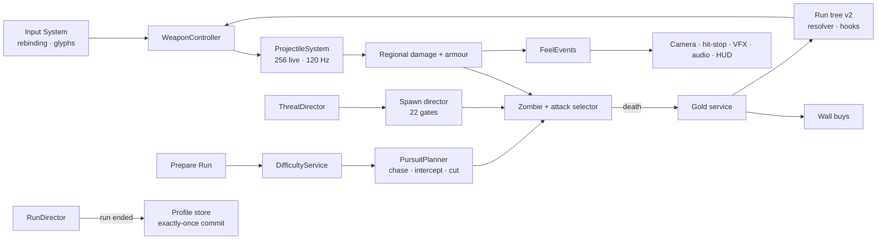

- **Data before code.** Every tunable lives in configuration sections, ScriptableObjects or JSON catalogs: weapons, the tree, the Awakening page, difficulty profiles, the world layout and strings.
- **No allocations on hot paths.** Shots, projectiles, damage events, armour, crowd steps and feel events run on pre-allocated buffers. The project also works with domain reload off.
- **One owner per concern.** One tier authority, one clock arbiter for time scale, one corpse-lifetime owner, one writer of global render settings and one writer of player data.
- **Crash-safe saves.** A save goes through fsync, read-back verification, a verified backup and an atomic replace. Corrupt files go to quarantine, and an OS lock lease guards the save. The save schema has lossless migrations from v1 to v6, and each finished run is committed exactly once.

---

## Performance

Measured on an Apple M1 Pro (Metal) at 1920 × 1080 with the top-down camera and a forced crowd of 40 zombies. Each tier is judged on three counted 60-second windows. These are the most recent measured numbers, from the acceptance run of 11 Oct 2026.

| Quality tier | Gate (mean frame) | Measured mean frame | ≈ fps |
| --- | ---: | ---: | ---: |
| **High** | ≤ 8.0 ms | 7.49 ms median window, 7.60 ms worst | ≈ 133 |
| **Cinematic** (default) | ≤ 14.71 ms | 12.02 ms worst window | ≈ 83 |

The macOS release build is 1.35 GB.

---

## Engineering profile

| Area | Snapshot (14 Oct 2026) |
| --- | ---: |
| C# total | ≈ 487,000 lines in 1,309 files |
| Gameplay runtime (`_Prototype`) | 680 files · ≈ 254,000 lines |
| Editor and art-pipeline code | 148 files · ≈ 53,000 lines |
| Test code | 481 files · ≈ 180,000 lines |
| Automated test cases | 3,591 (2,613 EditMode · 978 PlayMode) in 9 test assemblies |
| Last full run | EditMode 2,610 / 2,610 · PlayMode core 264 / 264 (R4 acceptance, 14 Oct 2026) |
| Shaders | 28 shaders · 11 HLSL includes · 1 compute shader |
| Content | 903 models · 385 animation clips · 1,032 textures · 1,962 sound files · 578 prefabs |
| Tooling | 142 scripts (Python, shell, Swift) with 1,504 Python test functions |
| Assembly definitions | 23 |
| Unity / URP | 2022.3.22f1 / 14.0.10 |
| Network | none, fully offline |

**Stack:** Unity 2022.3 LTS · URP 14 · C# · NUnit / Unity Test Framework · Input System · AI Navigation · Cinemachine · Python, zsh and Swift tooling · Blender asset pipeline

---

## Production pipeline

I own the design and every product decision, and I run the project with the discipline of a studio pipeline:

- **Domain packages.** Work is split by domain: foundation, combat, enemy AI, economy, world, animation, VFX, audio, UI and QA, plus environment, character, weapon and UI art packages. Each package lands with a written specification and acceptance criteria.
- **Gates on every change.**
  - A scripted integration gate checks allowed paths, scans for secrets and runs LFS and commit-format checks before a verified fast-forward or cherry-pick.
  - A compile gate builds the player scripts of the target build mode.
  - CI on `main` maps every red test to its owner.
  - Each release build gets an app manifest, a footprint gate and a smoke run.
- **Playtest-driven rounds.** After every release build I play the game and write down what is missing. That list becomes the next round of work packages. Rounds R1 to R4 each closed with a scripted acceptance run: test chains, captures, quiet-window performance cells, a sound pass and a release check, each with a machine-readable verdict.
- **Player data is sacred.** One Mac is shared through a FIFO machine-slot lock. Before any automated run, a guard snapshots the real player profile and restores and verifies it afterwards. History is never rewritten.
- **Evidence over claims.** Fixed top-down capture poses, MP4 capture with audio sync and seeded QA bots give every visible change a before-and-after record.

---

## Roadmap

- **Next:**
  - tree VFX polish: chain-beam scale, textured element ribbons, black-hole lens bending and the seeker trail on light stone;
  - restoring the "Second Thoughts" Awakening node;
  - moving the remaining developer command-line switches out of release builds;
  - renaming the executable.
- **Camera:** development and testing focus only on the top-down camera. Third- and first-person views still exist in the pause menu as legacy options.

---

Copyright © 2026 Erdem Emir Özer. All rights reserved. Gameplay and interface images are captured from the current build of the game. No reuse rights are granted.
