

  
  
<strong>Single-player space exploration, extraction, logistics and territorial control · Unity 2022.3 LTS · C#</strong>

  
<em>One ship, a deterministic universe, and every planet you claim held by what you built on it.</em>

  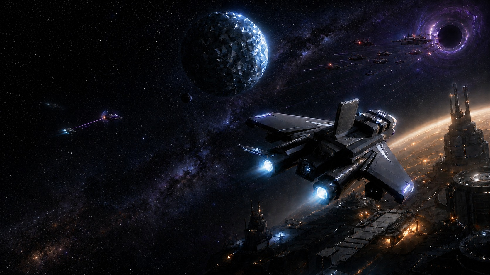

Key art

NEBULA is a single-player space game. You fly one ship by hand across a deterministic universe of four galaxies, scan planets, deploy drills, process what they produce, raise command posts and defenses, and hold planets against raids. A support fleet of scouts, collectors, engineers and escorts carries the work further than one ship can, and the strategic map only ever shows what the campaign has earned.

> **Status (16 Oct 2026):** private alpha, version 0.1.0 (build 1). The macOS release build is universal and passes its release smoke run; a Windows x64 player is built from the same pipeline but has not been run on Windows yet.
>
> The source is public as a portfolio snapshot at [ErdemEmirOzer/Nebula](https://github.com/ErdemEmirOzer/Nebula). Builds and production assets are private. Every image on this page comes from the current build.

| | |
| --- | --- |
| **Genre** | Single-player space exploration, extraction, logistics and territorial control |
| **Engine** | Unity 2022.3.22f1 LTS · built-in render pipeline · C# |
| **Platform** | macOS universal release builds; Windows x64 build path |
| **World** | Deterministic universe of 4 galaxies · systems revealed through 4 knowledge levels · 3–8 planets per system |
| **Economy** | 5 resource families · 5 rarities · instant recipe processing · cargo and orbital logistics |
| **Fleet** | Scout, Collector, Engineer and Escort vehicles with Mk upgrades |
| **Combat** | Shield / armour / hull · Laser, Plasma and EM hardpoints · raids and pirate bases |
| **Progression** | Character levels 1–100 · 12 ship modules in 4 branches, tiers T1–T5 |
| **Tutorial** | 11 chapters, 176 scripted steps |
| **Saves** | 3 slots × 3 rotating backups · schema v15 with migrations · 5-minute autosave |
| **Language** | Turkish-first interface |
| **Codebase** | ≈ 124k lines of runtime and editor C# · ≈ 118k lines of tests · 3,857 test declarations |

---

## Contents

1. [Screenshots](#screenshots)
2. [How a session plays](#how-a-session-plays)
3. [World and navigation](#world-and-navigation)
4. [Extraction, processing and control](#extraction-processing-and-control)
5. [Fleet, combat and threats](#fleet-combat-and-threats)
6. [Strategic map](#strategic-map)
7. [Progression and tutorial](#progression-and-tutorial)
8. [Interface and accessibility](#interface-and-accessibility)
9. [Architecture](#architecture)
10. [Build footprint](#build-footprint)
11. [Engineering profile](#engineering-profile)
12. [Production pipeline](#production-pipeline)
13. [Roadmap](#roadmap)

---

## Screenshots

### Gameplay

  

The start of a campaign in Albion: the star's corona ahead, flight HUD on

<table>
  <tr>
    <td width="50%"> Facing the star: a metal world and an ocean world on their orbits</td>
    <td width="50%"> The Albion system from the ship: five planets and their orbit trails</td>
  </tr>
</table>

### The world

  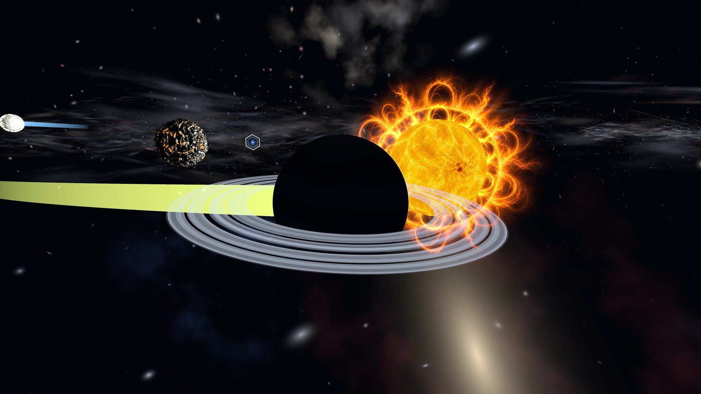

A ringed gas giant crossing its star

<table>
  <tr>
    <td width="50%">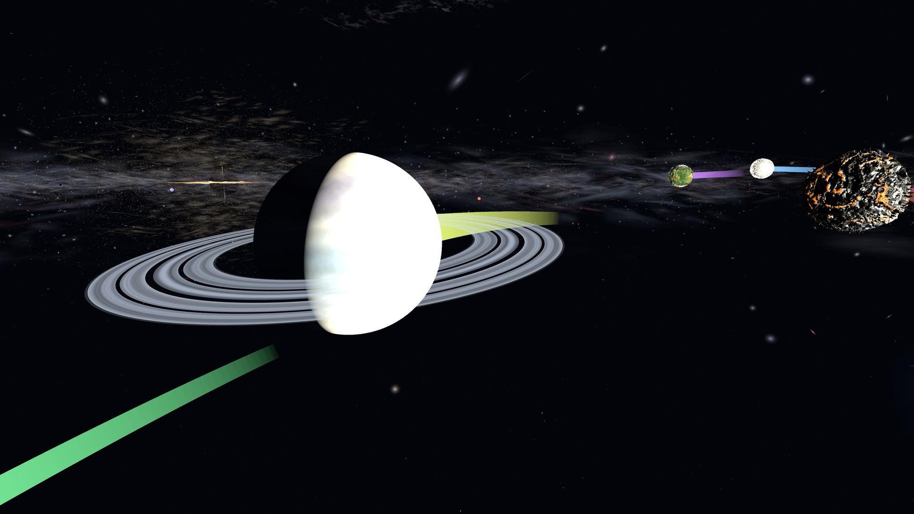 The same giant, lit, with its neighbours further out</td>
    <td width="50%">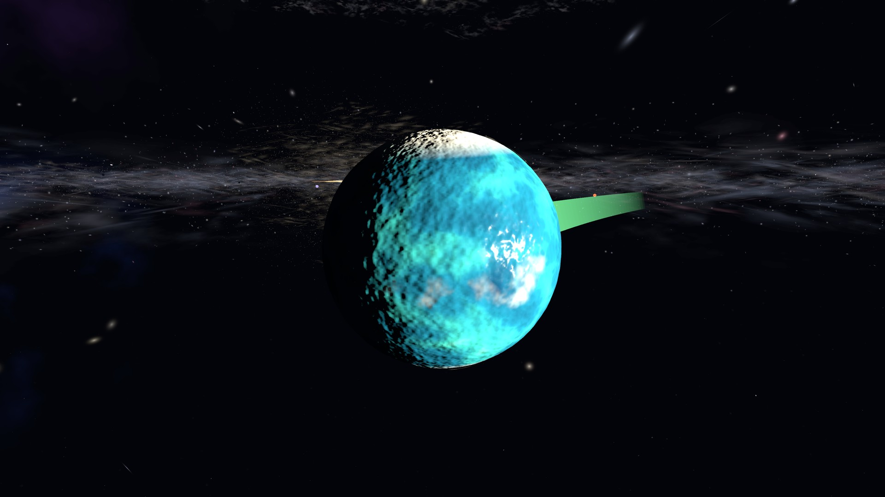 An ocean world: the Water resource family</td>
  </tr>
  <tr>
    <td width="50%"> A forest world: the Wood resource family</td>
    <td width="50%">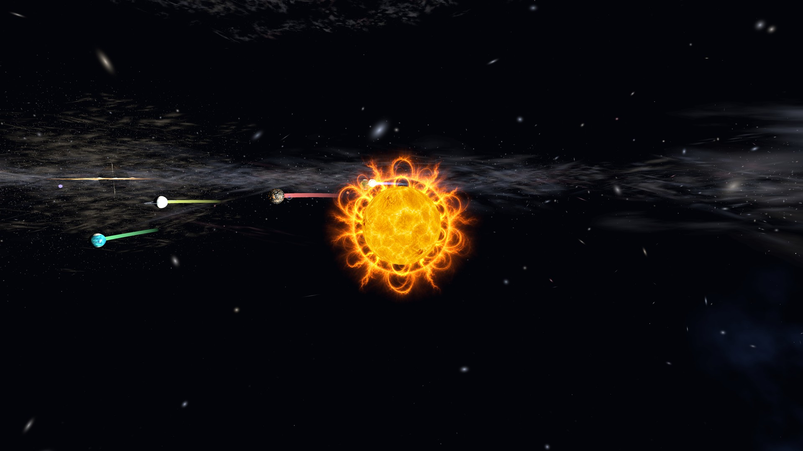 The whole system, low across the orbital plane</td>
  </tr>
</table>

### Strategic map

  

The whole universe: four galaxies, from a diagonal angle

<table>
  <tr>
    <td width="50%">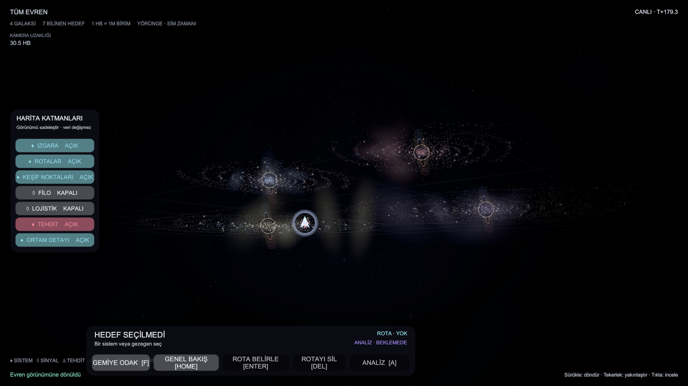 From the side: the galaxies edge-on</td>
    <td width="50%">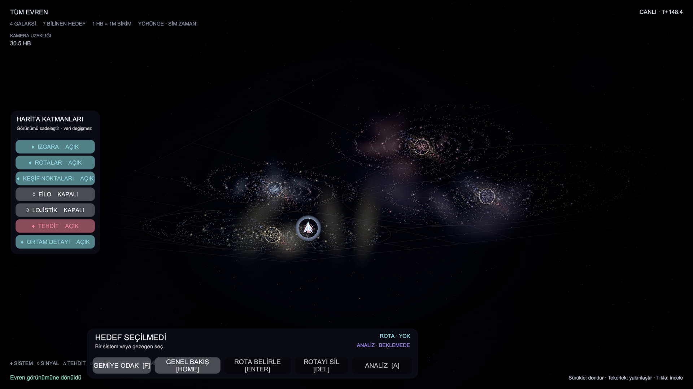 Low over the map grid</td>
  </tr>
  <tr>
    <td width="50%"> Overview from above, as the map opens</td>
    <td width="50%">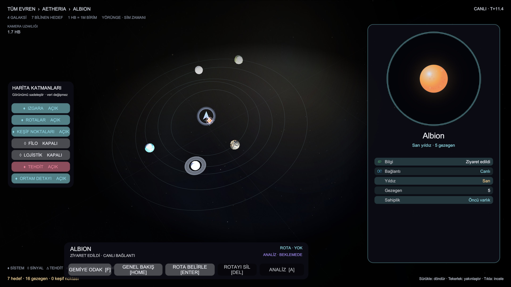 System level: Albion, its five planets and the inspector</td>
  </tr>
</table>

### Command menu

<table>
  <tr>
    <td width="50%">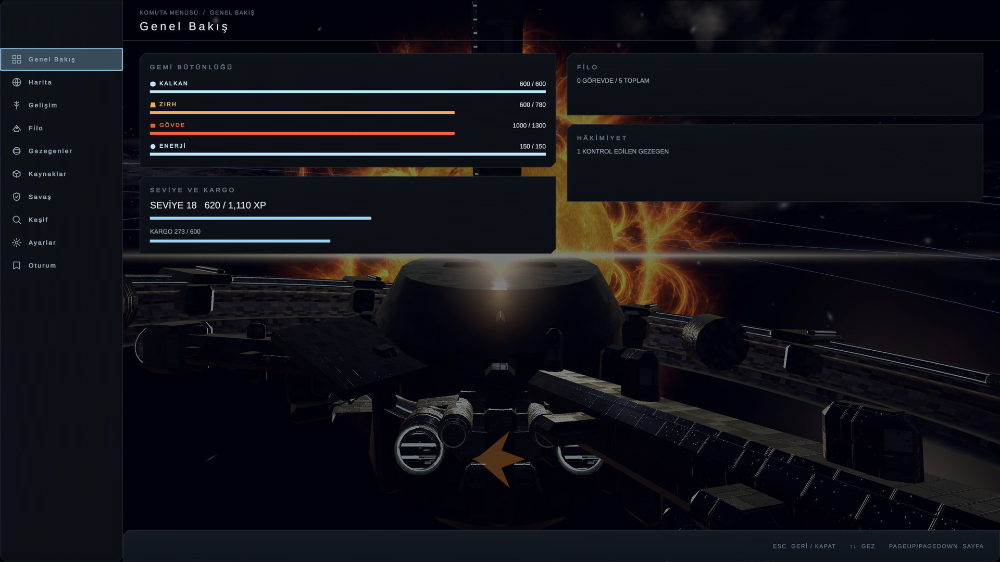 Overview: vitals, level, cargo, fleet and planetary control</td>
    <td width="50%">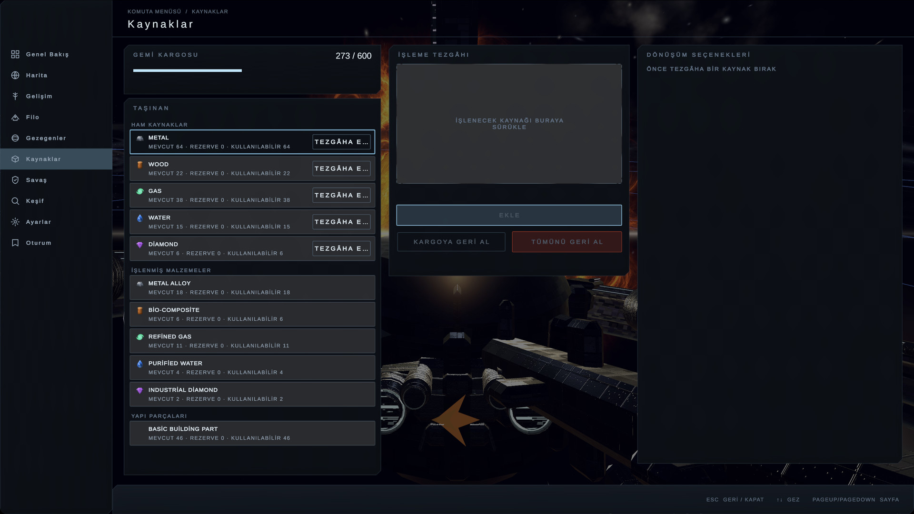 Resources: the hold, the processing bench and its recipes</td>
  </tr>
  <tr>
    <td width="50%"> Progression: level 18 and the twelve ship modules</td>
    <td width="50%"> Fleet: five vehicles, production and missions</td>
  </tr>
  <tr>
    <td width="50%"> Planets: a controlled world and its control timeline</td>
    <td width="50%"> Discovery: known systems by knowledge level</td>
  </tr>
  <tr>
    <td width="50%"> Combat: hardpoints, weapon production and threats</td>
    <td width="50%">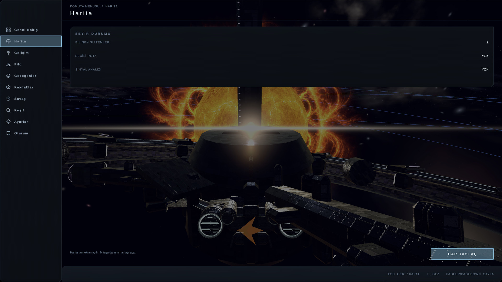 Map: route state and the way into the strategic map</td>
  </tr>
  <tr>
    <td width="50%">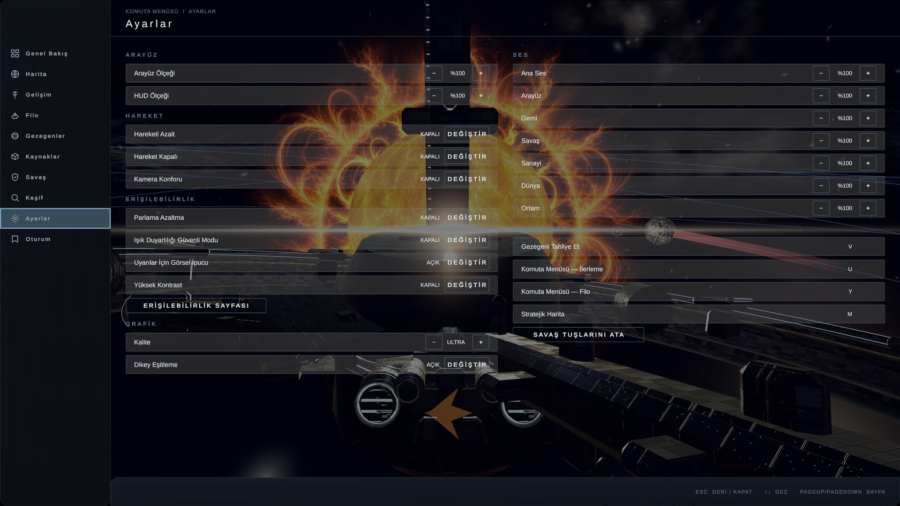 Settings: interface, motion, accessibility and key bindings</td>
    <td width="50%"> Session: three save slots, restart and exit</td>
  </tr>
</table>

### Front end

<table>
  <tr>
    <td width="50%"> Main menu, with a campaign to continue</td>
    <td width="50%"> Load: three save slots</td>
  </tr>
  <tr>
    <td width="50%">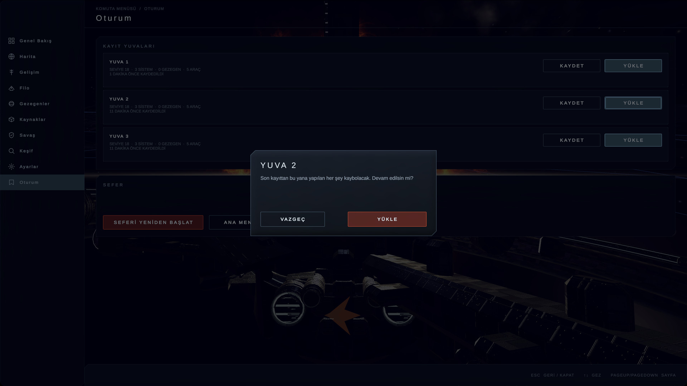 The shared confirmation surface</td>
    <td width="50%"> Tutorial: eleven chapters</td>
  </tr>
  <tr>
    <td width="50%">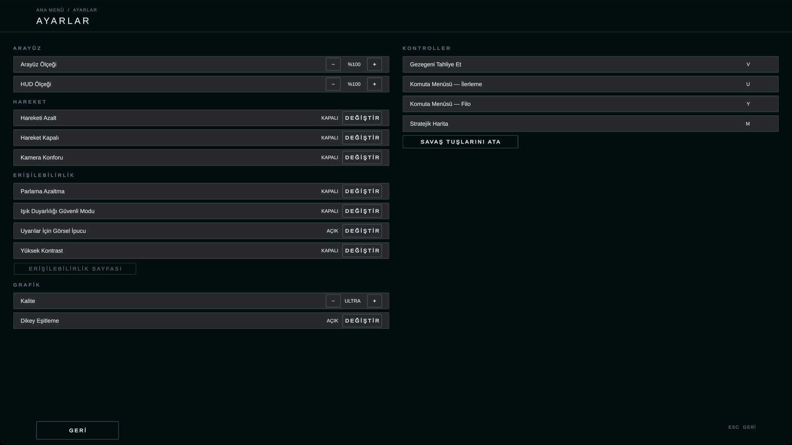 Settings</td>
    <td width="50%">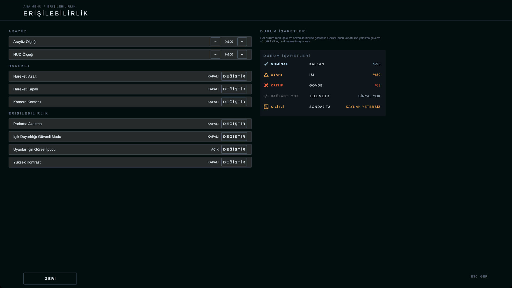 Accessibility, with the status-cue legend</td>
  </tr>
</table>

### In motion

<table>
  <tr>
    <td width="50%"> Turning across the system, HUD on</td>
    <td width="50%"> An orbit of the universe on the strategic map</td>
  </tr>
  <tr>
    <td colspan="2"> The star's live corona over the starting position</td>
  </tr>
</table>

Gameplay, map, menu and front-end images come from the macOS release player loading a mid-campaign save, built in the Unity Editor through the game's own services. World images and the corona and universe animations are rendered in the Editor through the game and map cameras, with no interface and with orbit guides off.

---

## How a session plays

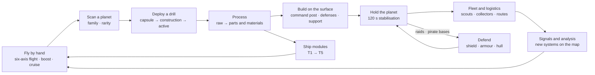

- **Scan and drill.** Holding the scan key reveals a planet's resource family (Metal, Wood, Gas, Water, Diamond) and rarity. The first drill comes from a one-use pioneer kit; later drills cost Basic Building Parts. A drill drops as a capsule, constructs, then fills its own storage until the ship collects it.
- **Process.** On the Resources page, raw material goes onto a bench and converts instantly: two raw units into one Basic Building Part, or three into a family material such as Metal Alloy or Refined Gas.
- **Build and hold.** A command post and at least one active defense on a scanned planet with a working drill start a 120-second stabilisation. Planets move through Unowned, Developing, Controlled, Contested and Lost.
- **Explore.** Signals point toward unknown systems. Analysis locates them and a visit reveals their planets.

## World and navigation

- **One seed, one universe.** Galaxies, spiral arms, sectors and systems are generated from the campaign seed with FNV-1a and mixed hash channels. The world and the strategic map read the same star field, so they can never describe different stars.
- **Nothing generated is saved.** A system manifest is regenerated from the seed and its coordinates on demand; only the campaign's changes to it are saved, as a system delta.
- **Streaming.** The current system is fully materialized, its neighbours are kept warm, and distant systems keep simulating at 1 Hz: economy, raids, probes and pending attacks continue where the player is not.
- **Flight.** Six-axis manual flight with roll and boost, a deep-space cruise for long distances, heading lock and an arrival assist. A floating origin keeps precision across distances of millions of units.

## Extraction, processing and control

- Drills, command posts, laser and plasma defenses, sensor arrays and maintenance platforms each run a real lifecycle (capsule in transit, construction, active) and can be upgraded.
- Every build, upgrade and production job **reserves** its cost first and consumes it on completion. Restored jobs re-establish their own reservations, so a save and load can never produce a free structure or lock resources forever.
- Quick asset packages send a drill, a command post and a laser in one transaction; evacuation and reclaim hand a planet back and take it again.

## Fleet, combat and threats

- **Fleet.** Scouts, Collectors, Engineers and Escorts are produced in the ship's hangar, upgraded through Mk tiers and sent on physical missions. Orbital logistics centres run collector routes and transfers inside a system.
- **Combat.** Shield, armour and hull with Laser, Plasma and EM hardpoints, each with its own heat. One shared enemy state machine drives every hostile; only their data differs.
- **Threats.** Encounters, raids on controlled planets, pirate bases, wreckage and salvage, physical repair with safe zones, and an emergency shutdown that the player has to recover from.

## Strategic map

- Universe → galaxy → system, on live campaign data. Unknown systems are absent; a signal gives a direction, a located system gets a position, and a visited one shows its planets, structures and points of interest.
- Routes are planned on the map and flown by hand. There is no teleport.
- Layers for grid, routes, discovery points, fleet, logistics, threat and ambient detail simplify the view without changing any data.

## Progression and tutorial

- Character levels 1–100 and development points.
- Twelve ship modules across four branches (Industry, Exploration, Defense, Nuclear), tiers T1–T5, gated by character level and campaign milestones.
- An eleven-chapter tutorial (A–K) of 176 steps, from first flight to campaign and session management. Every step is a scripted condition on real gameplay state, not a cutscene.

## Interface and accessibility

- A single interface shell with a screen stack and focus handling; a ten-page command menu over the live world.
- Keyboard and mouse with runtime rebinding, collision checks between bindings, and bindings stored apart from campaign saves.
- Interface scale 80–140%, reduced motion, motion off, flash reduction and high contrast; status cues pair colour with a symbol and text.
- Three save slots with three rotating backups each, migrations across every schema up to v15, integrity checks and a five-minute autosave.

---

## Architecture

One explicit composition root boots the game. It validates content and configuration, resolves the campaign seed and runs installers in a fixed order. Every dependency is written once into a typed, set-once context, and a partial boot unwinds through a session lifetime instead of leaving a half-built world behind.

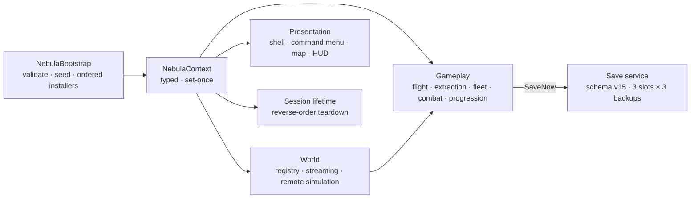

- **One owner per concern.** One composition root, one context, one session lifetime, one writer of each save slot.
- **Pure decisions, thin adapters.** A pure resolver decides and a MonoBehaviour only gathers positions and applies the result, so the rules are tested in EditMode without a scene.
- **Never trust a test that cannot fail.** Graphics tests run on a real device, key capture tests fail rather than skip without one, and new gates are mutation-verified before they count.

## Build footprint

The macOS release player went from **3.47 GiB to 613 MiB** (3,728,163,448 B on 10 Aug 2026 to 642,595,538 B in the current build). 85% of the old player was one file of texture data: the 245 model files of the visual library embedded about 926 texture instances that resolved to only about 62 distinct images, and Unity imported them uncompressed. Textures are now de-duplicated on a composite key, compressed with BC7, and the model prefabs are rebound onto shared materials.

## Engineering profile

| Area | Snapshot (16 Oct 2026) |
| --- | ---: |
| C# total | 891 files · 242,171 lines |
| Gameplay runtime | 491 files · 114,577 lines in 23 domain folders |
| Editor tooling | 25 files · 9,745 lines |
| Test code | 375 files · 117,849 lines |
| Test declarations | 3,857 (2,976 EditMode · 881 PlayMode) |
| PlayMode gate | 4 lanes (ReleaseRegression, Graphics, Soak, Diagnostic) at leaf level, 59 mutation-verified self-tests |
| Assembly definitions | 6 |
| Shaders | 12, hand-written |
| macOS release player | 613 MiB, universal |
| History | 307 commits, 22 Jul → 16 Oct 2026 |
| Unity | 2022.3.22f1 |
| Network | none, fully offline |

**Stack:** Unity 2022.3 LTS · C# · built-in render pipeline · NUnit / Unity Test Framework · glTFast · TextMesh Pro · Python and zsh tooling

---

## Production pipeline

I own the design and every product decision, and I run the project like a studio pipeline:

- **Vertical slices.** The game grew in slices, each closed with a written specification, acceptance criteria and its own test fixtures. When a slice's tests missed something, a consistency or integrity slice followed with the root cause written into the fix.
- **Scoped tests in the loop, whole-suite gates at milestones.** Day-to-day changes run only the fixtures they touch; the full PlayMode suite runs as a four-lane gate across disposable cloned mirrors of the project. Results only count when the hash of the C# source and the hash of everything a player can see both match.
- **Audits that end in a ledger.** A general audit recorded 104 defects, each with a root cause, a fix strategy and its regression fixtures; 102 are closed as fixed and 2 were withdrawn.
- **Player data is sacred.** In the Editor every persistent writer falls back to a throwaway scratch folder. Release smoke runs use an isolated data root that cannot be enabled by accident, and they fail unless the player's real folders are byte-identical afterwards.
- **Evidence over claims.** Release builds come with a build report and a smoke result. A release build refuses to build if a shader the code asks for by name would be stripped, a rule added after a release candidate rendered every procedural material magenta.

## Roadmap

- **Next:**
  - running the Windows player on real Windows hardware through its packaged smoke harness;
  - signing and notarization for macOS;
  - a first external playtest and a long-session soak on a player machine;
  - a measured performance budget on minimum hardware;
  - closing the licence and provenance record for the remaining art assets;
  - settling the open star-energy and nuclear-chain design decisions;
  - final audio, music, lighting and animation polish.

---

Copyright © 2026 Erdem Emir Özer. All rights reserved. Images are captured from the current build of the game. No reuse rights are granted.
